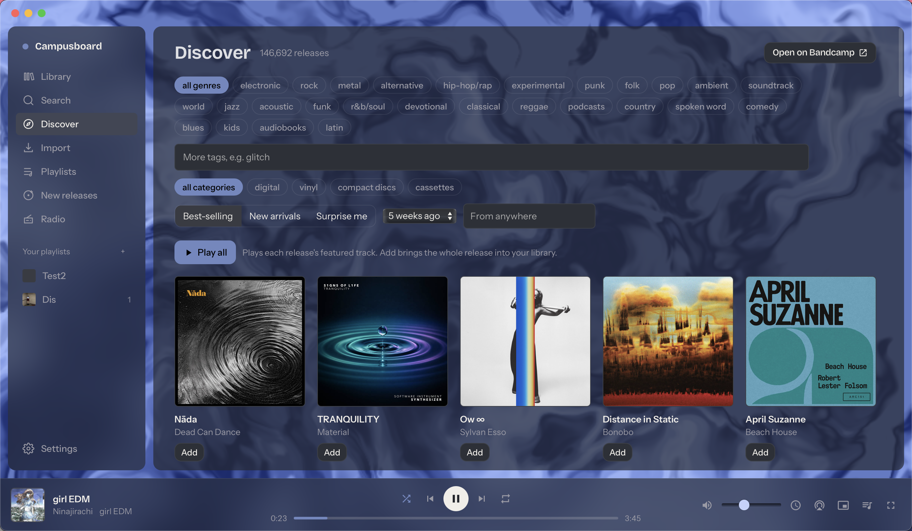

<p align="center">
  
</p>

<h1 align="center">Campusboard</h1>

<p align="center">A personal Mac app for listening to Bandcamp, named after the climbing training board. Paste a link, keep a library, make playlists, and play in a window that takes its colours from the album art.</p>

<p align="center"><a href="https://github.com/zeyuyang42/Campusboard/releases/latest"><b>Download the latest release</b></a> (macOS 13.3+, Apple Silicon)</p>




<p align="center"><a href="docs/screenshots.md">More screenshots</a>: Search, Radio and Now playing</p>

Bandcamp has no public API, so Campusboard reads the JSON Bandcamp embeds in its
own pages (the data its player uses) and streams from Bandcamp's CDN at 128 kbps.
It needs no account, re-hosts nothing, and talks only to bandcamp.com and its CDN:
no telemetry, no updater (it tells you when a newer release exists). Every album
page keeps a **Buy on Bandcamp** link; please buy what you keep coming back to.
It is an unofficial client, not affiliated with Bandcamp; see
[Bandcamp's rules](#bandcamps-rules) before you use it.

## Install

1. Download the `.dmg` from the [releases page](https://github.com/zeyuyang42/Campusboard/releases/latest), open it, and drag **Campusboard** to Applications.
2. The app isn't signed with an Apple Developer ID, so macOS refuses it the first
   time. Right-click the app, choose **Open** and confirm (or System Settings →
   Privacy & Security → **Open Anyway**). Once is enough.

To update, quit the app and replace it; the library and settings stay in
`~/Library/Application Support/com.bandcampplayer.app/` (the identifier keeps the
app's old name, Bandcamp Player, so updates find the same library). Coming from
Bandcamp Player: delete **Bandcamp Player.app** once Campusboard is installed.
Intel Macs can build from source (see [Development](#development)).

## Using it

### Finding music
- **Import**: paste an album or track link. An artist or label link lists every
  release with checkboxes, so you import only what you want. Imports run at one
  page per second and resume after a restart. A link dragged from a browser onto
  the window works the same way.
- **Search** searches Bandcamp: **Add** imports, **Browse releases** opens an
  artist or label, and the play button plays a release without importing it.
- **Discover** is Bandcamp's discover in the app: genres and tags, format, time
  window, place, Best-selling / New arrivals / Surprise me. Click a cover to hear
  its featured track; **Add** the ones you like.
- **Radio** plays Bandcamp Radio episodes as one long track. Now playing shows
  the tracklist with the release on air, ready to import or buy.
- **New releases**: while the app is open it checks one library artist every few
  minutes (each at most once a day) and lists what's new, to import or dismiss.
- **Your collection**: Settings → Bandcamp account. Enter your username and
  **Sync now** imports your purchases and wishlist (then filter with Library →
  Show). Optionally paste the `identity` cookie from a logged-in browser for a
  private collection and MP3 V0 streams of your purchases; it stays in the local
  database and goes only to bandcamp.com. Syncs repeat at most once a day.

Previews (Search, Browse, Discover) and Radio episodes don't count in listening
history and can't go into playlists.

### Your library
- **Album pages**: tracks, tags, description and lyrics, a 1-5 star rating and a
  note of your own. The artist's name opens everything of theirs you have.
- **Library tabs**: Albums (filter, Show, Sort, and a bar to play, shuffle, queue
  or add everything that matches), Artists, Tracks, Tags, and History, which lists
  what you played by day and has **Stats** for your top artists, albums and tags.
- **Playlists**: right-click a track or album, or select several (Shift/Cmd-click)
  and use the bar. Drag to reorder. A **smart playlist** is a saved rule (rating,
  tag, text, played recently or not, sort, limit) refilled each time it opens.
- **Offline listening**: **Make available offline** on an album page saves its
  streams one track at a time; saved tracks play without a connection. Settings →
  Storage shows the total, sets a limit and removes everything. These copies are
  for listening in the app, not purchases.
- Removing an album, playlist or playlist entry shows a few seconds of **Undo**
  instead of asking first.

### Playing
- **Now playing**: `N` or click the artwork for a full view with queue and
  lyrics. Tracks over 20 minutes and Radio episodes resume where you left them.
- **Gapless and crossfade** (Settings → Playback): the next track starts as the
  current one ends; crossfade (up to 10 s) blends tracks from different albums.
- **Sleep timer**: Playback → Sleep Timer, 15-60 minutes or the end of the track
  or album, fading out.
- **Mini player**: Window → Mini Player (`⌘⇧M`), a small always-on-top window
  with a large-artwork layout.
- **AirPlay**: the AirPlay button appears in the player bar when a speaker is
  nearby (tracks then play back to back without gapless; Control Center → Sound
  routes the whole Mac and keeps it).
- **When the window is closed** the music keeps playing; the Dock icon brings it
  back and `⌘Q` quits. Control Center's Now Playing, the media keys and AirPods
  work throughout. Settings can add a menu-bar icon and track-change
  notifications.

### Look
- **Backdrop**: the playing album's colours fill the window behind frosted panels.
  Settings → Backdrop: Generative (fluid ink, aurora, glitch or lava blobs),
  Ambient wash, or Conservative (a faint wash and solid panels), plus Intensity
  and Motion. It pauses with the music, stops while the window is hidden and
  follows Reduce motion.
- **Themes**: presets (including High contrast), system, dark or light, colours,
  fonts, corners, density and a background image. Themes export and import as
  [files](#theme-files).

### Keyboard
`⌘K` opens the command palette (albums, artists, playlists, actions). `Space`
play/pause, `←`/`→` seek 5 s, `Shift+←`/`→` previous/next, `↑`/`↓` volume, `S`
shuffle, `R` repeat, `Q` queue, `N` now playing, `/` search, `Esc` close. Help →
Keyboard Shortcuts lists the rest.

### Moving to another Mac
Settings → Library → **Export library** writes your albums, playlists, history,
theme and settings to a JSON file (never your cookie); **Import library** on the
other Mac fetches the albums again at the usual pace. **Back up library database**
saves a complete copy of the library file.

## Theme files

A theme is a JSON file validated on import: colours, fonts, numbers and an https
image URL only, never CSS or scripts, so a shared theme can't break the app.

```json
{
  "version": 1,
  "name": "Dusk",
  "mode": "dark",
  "palette": { "surface": "#23262D", "surfaceRaised": "#2C3038", "text": "#F1EEE9",
               "textMuted": "#9A9AA6", "accent": "#5BB6D1", "danger": "#E06A5E" },
  "radius": 10,
  "density": "comfortable",
  "fonts": { "display": "Bricolage Grotesque Variable", "ui": "Instrument Sans Variable" },
  "ambient": 0.6,
  "background": { "source": "none", "value": "", "blur": 12, "dim": 0.5 },
  "backdrop": { "mode": "morph", "style": "ink", "intensity": 1, "motion": "drift" }
}
```

- `mode`: `"dark"`, `"light"` or `"system"`. A system theme gives both sides as
  `paletteDark` and `paletteLight` (same keys as `palette`).
- `accent` applies only when nothing plays; otherwise the accent comes from the
  artwork, clamped so text stays readable. `"contrast": "high"` holds it to 7:1.
- `backdrop.mode`: `"conservative"`, `"wash"` or `"morph"`; `style`: `"ink"`,
  `"aurora"`, `"glitch"` or `"lava"`; `intensity` 0-1; `motion` `"drift"` or
  `"still"`. Without `backdrop` a theme gets the default shown above.

## Development

Requires Node 22.5+, Rust 1.90+ and the Xcode command line tools. Dev runs and
tests use a separate `library-dev.db`, never the installed app's library.

```bash
npm install
npm run dev          # Tauri window with hot reload (Vite on :5173)
npm run build        # .app and .dmg in src-tauri/target/release/bundle/
npm test             # core and web tests, offline
npm run typecheck
VITE_BROWSER_MODE=1 npm run web:dev   # the UI in a browser, SQLite in WebAssembly
npm run scrape -- <url>               # what the parser sees on a Bandcamp page
```

```
packages/core/   Bandcamp parsing, data layer, services, theme and palette
web/             React UI (Vite), bound to Tauri's SQLite and HTTP plugins
src-tauri/       Rust shell: plugins, migrations, capabilities, bundle config
```

[AGENTS.md](AGENTS.md) explains how the app works and how to change it safely.
If Bandcamp changes its markup, imports fail with `parse_failed`: fix the parser
in `packages/core/src/scrape/`, re-save fixtures (`npm run fixtures:save`) and
re-run the tests. Such a failure is worth an issue; planned work is tracked as
issues labelled `feature`. Windows, Linux and signed builds don't exist yet.

## Bandcamp's rules

Campusboard asks Bandcamp for one page per second, caches pages for ten minutes,
fetches only what you ask for, and backs off when Bandcamp shows its bot check.
Please don't point it at whole labels you won't listen to.

Still, Bandcamp's
[Acceptable Use Policy](https://get.bandcamp.help/articles/15263124-bandcamp-s-acceptable-use-and-moderation-policy)
forbids scraping "through the use of scripts, robots, bots, spiders, scrapers,
crawlers, or other automated means", so using an unofficial client is your call
and your risk, and Bandcamp may block it at any time. Its
[Terms of Use](https://bandcamp.com/terms_of_use) allow streamed and downloaded
music, offline copies included, for personal, non-commercial use only.

## Licence

[PolyForm Noncommercial 1.0.0](LICENSE): use, copy, change and share the code for
any non-commercial purpose. Commercial use needs separate permission. Keep the
licence and its `Required Notice:` line with any copy you share.
