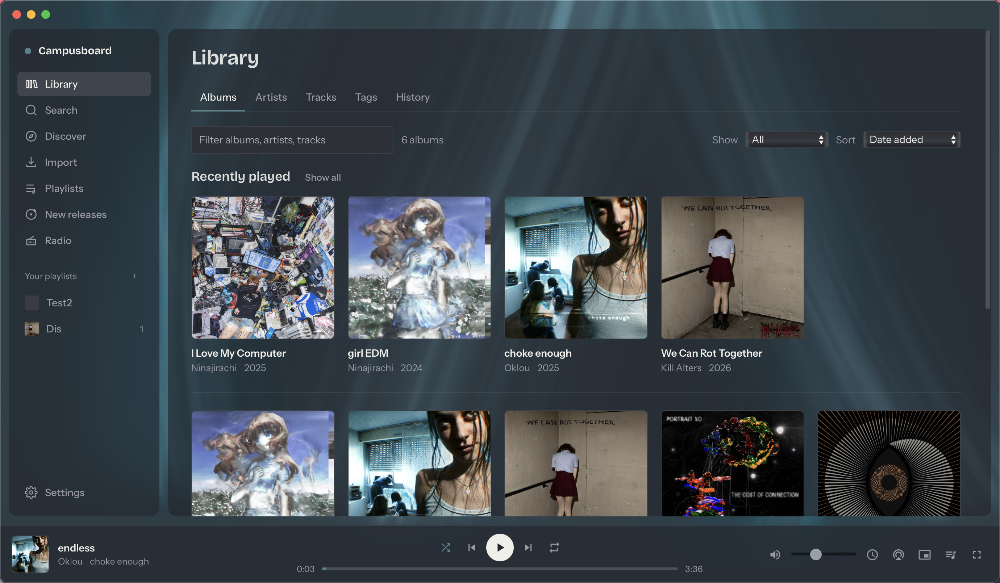
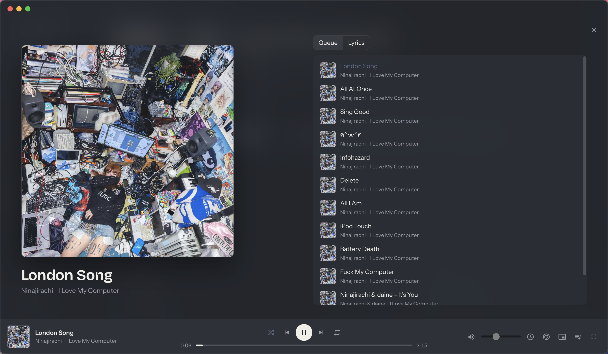

<p align="center">
  
</p>

<h1 align="center">Bandcamp Player</h1>

<p align="center">A personal Mac app for listening to Bandcamp. Paste a link, keep a library, make playlists, and play in a player that takes its colors from the album art.</p>

<p align="center"><a href="https://github.com/zeyuyang42/bandcamp-player/releases/latest"><b>Download the latest release</b></a> (macOS, Apple Silicon)</p>





Bandcamp has no public API, so the app reads the JSON that Bandcamp embeds in
its own album pages (the same data the official player uses) and streams audio
straight from Bandcamp's CDN at 128 kbps. Nothing is downloaded or re-hosted.
Every album page keeps a **Buy on Bandcamp** link. Bandcamp's terms allow
personal, non-commercial use. Please buy what you keep coming back to.

## Install (macOS, Apple Silicon)

1. Download the `.dmg` from the [releases page](https://github.com/zeyuyang42/bandcamp-player/releases/latest), open it, and drag **Bandcamp Player** to Applications.
2. The app is not signed with an Apple Developer ID, so the first time macOS
   will refuse to open it. Right-click the app, choose **Open**, and confirm.
   If that option is missing, go to System Settings → Privacy & Security and
   click **Open Anyway**. You only need to do this once.

Requires macOS 13.3 or later. Your library lives in
`~/Library/Application Support/com.bandcampplayer.app/library.db`.

## Using it

- **Import**: paste `https://artist.bandcamp.com/album/...` or `/track/...`.
  An artist or label URL opens a browse page listing every release with
  checkboxes, so you import only what you want (or everything). Imports run one
  page per second and resume after a restart.
- **Search**: searches Bandcamp directly; "Add" imports an album or track,
  "Browse releases" opens an artist's or label's page.
- **Playlists**: right-click any track or album, or select several tracks
  (click, Shift-click, Cmd-click) and use the bar that appears. Drag rows to
  reorder.
- **Now playing**: press `N` or click the artwork in the dock for a full view
  with queue and lyrics.
- **Themes**: Settings → pick a preset, adjust colors, fonts, corner radius,
  density, the album-art wash and an optional background image. Export writes a
  `.theme.json` you can send to a friend; Import loads one.

Shortcuts: `Space` play/pause · `←`/`→` seek 5 s · `Shift+←`/`→` previous/next ·
`↑`/`↓` volume · `S` shuffle · `R` repeat · `Q` queue · `N` now playing ·
`/` search · `Esc` close.

## Theme files

A theme is a JSON file validated on import. Only colors, fonts, numbers and an
https image URL are accepted; a theme cannot contain CSS or scripts, so a shared
theme can't break the app. Example:

```json
{
  "version": 1,
  "name": "Dusk",
  "mode": "dark",
  "palette": { "surface": "#23262D", "surfaceRaised": "#2C3038", "text": "#F1EEE9",
               "textMuted": "#9A9AA6", "accent": "#5BB6D1", "danger": "#E06A5E" },
  "radius": 10,
  "density": "comfortable",
  "fonts": { "display": "Bricolage Grotesque Variable", "ui": "Instrument Sans Variable" },
  "ambient": 0.6,
  "background": { "source": "none", "value": "", "blur": 12, "dim": 0.5 }
}
```

`accent` is only used when nothing is playing; while a track plays, the accent
and the backdrop come from its artwork, clamped so text stays readable.

## Development

Requires Node 22.5+, Rust 1.90+ and Xcode command line tools.

```bash
npm install
npm run dev          # Tauri window with hot reload (Vite on :5173)
npm run build        # .app and .dmg in src-tauri/target/release/bundle/
npm test             # parser, data-layer, theme and palette tests (offline)
npm run typecheck
```

Browser-only mode for UI work and screenshots (same code, SQLite in WebAssembly,
Bandcamp pages fetched through a Vite middleware):

```bash
VITE_BROWSER_MODE=1 npm run web:dev   # http://localhost:5173
```

```
packages/core/   parsers, async Db interface, repos, services, theme + palette engines
web/             React UI (Vite); binds core to Tauri's SQLite + HTTP plugins
src-tauri/       Rust shell: plugins, migrations, capabilities, bundle config
```

- `packages/core/src/scrape/` parses Bandcamp pages. `parseTralbum.ts` reads the
  `data-tralbum` attribute on album/track pages; `parseMusic.ts` reads an
  artist's `/music` page; `search.ts` wraps Bandcamp's autocomplete endpoint.
  All HTTP goes through `FetchQueue`, serial at one request per second with a
  normal browser User-Agent.
- Stream URLs expire about 24 hours after a page is fetched; the player asks
  core for a fresh URL before each play and retries once on a media error.
- `npm run scrape -- <url>` prints what the parser sees; `npm run smoke:live`
  re-parses a known page. If Bandcamp changes its markup, imports fail with
  `parse_failed`; fix the parser, re-save fixtures with `npm run fixtures:save`,
  re-run tests.

## Not yet

Syncing purchased items with your Bandcamp login (higher-quality streams),
offline caching, Windows/Linux builds, Mac media keys (depends on the webview),
custom artist domains. Tracked as issues labelled `feature`.
