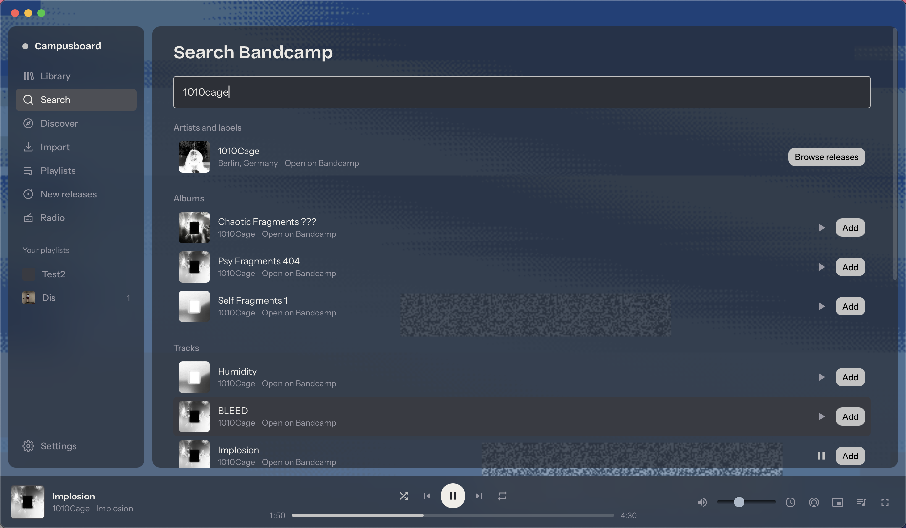
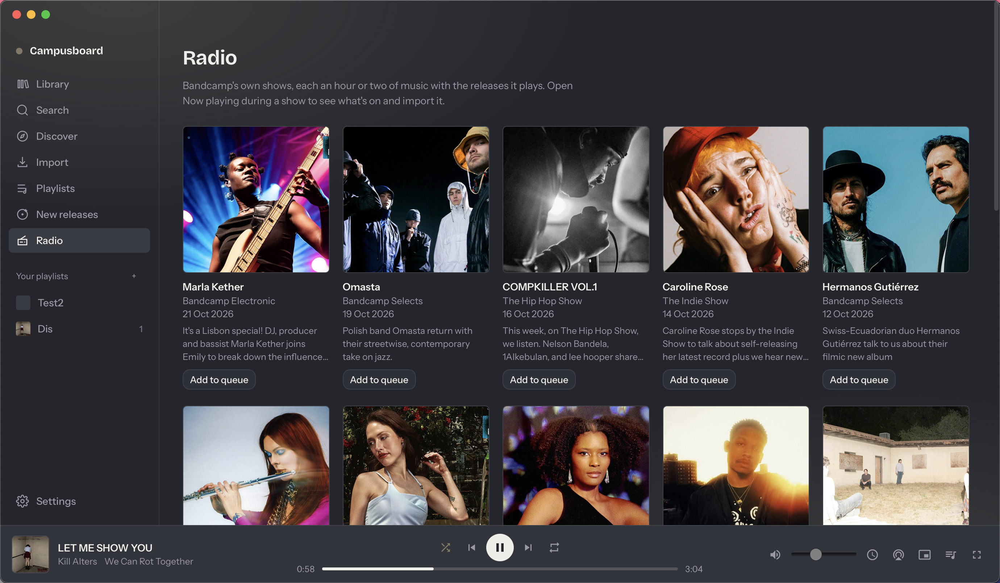

# Screenshots

Campusboard 0.10.0 on macOS. The backdrop takes its colours from the album that is playing.

## Library
Recently played and the album grid, with the Aurora backdrop.

## Discover
Bandcamp's discover with genre, format and time filters, with the Fluid ink backdrop.

## Search
Search results play before you add them, with the Glitch backdrop.

## Radio
Bandcamp Radio shows, each one queued as a single episode.

## Now playing
The full-window view with the queue beside the cover.

